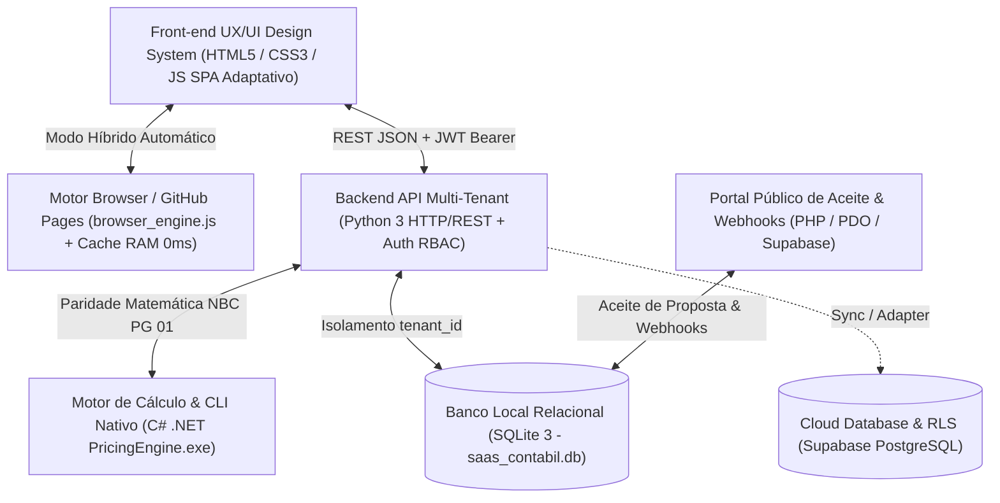

# Plano Mestre Unificado — Arquitetura SaaS, Precificação, Propostas, CRM & Implementação UX/UI Front-end

> [!IMPORTANT]
> Este documento unifica o **Diagnóstico e Plano Técnico Multi-Tenant (Backend, Banco de Dados, Motor de Cálculo NBC PG 01 e Integrações)** com o **Plano de Implementação UX, UI e Front-end (Padrões de Usabilidade, Design System Próprio Azul/Branco/Cinza e Fluxos Guiados)**.

---

## Parte I — Diagnóstico Técnico (Auditoria) e Arquitetura Multi-Tenant

### 1. Auditoria do Sistema Existente e Preservação Matemática
Foi realizada a auditoria reversa completa da aplicação base (`https://precificador-de-honorarios-vgldigital.replit.app/`), preservando integralmente todas as fórmulas conformes à **NBC PG 01** e **Res. CFC 1.590/2020**:

1. **Custo da Hora Produtiva (`L`):**
   $$\text{CustoHora} = \frac{\text{CustoFixoMensal}}{\text{HorasProdutivasMes}}$$
2. **Hora Técnica Aplicada (`P`) — Margem vs. Markup:**
   $$\text{HoraTecnica} = \text{CustoHora} \times \left(1 + \frac{\text{MargemAlvo\%}}{100}\right)$$
3. **Horas Base por Regime e Atividade (`le`):**
   $$\text{HorasRegimeAtividade} = \text{HorasRegime} \times \text{MultiplicadorAtividade}$$
   - *Regimes padrão:* MEI ($0{,}6\text{h}$, ref. R\$ 90–180), Simples Nacional ($3{,}0\text{h}$, ref. R\$ 350–900), Lucro Presumido ($6{,}5\text{h}$, ref. R\$ 700–2.200), Lucro Real ($14{,}0\text{h}$, ref. R\$ 1.800–7.000).
   - *Multiplicadores de Atividade padrão:* Comércio ($1{,}00\times$), Serviços ($1{,}05\times$), Indústria ($1{,}35\times$).
4. **Horas de Folha (`R`), Sócios (`V`) e Filiais (`J`):**
   $$\text{HorasFolha} = \text{Funcionarios} \times 0{,}45\text{h}, \quad \text{HorasSocios} = \text{Socios} \times 0{,}35\text{h}, \quad \text{HorasFiliais} = \text{Filiais} \times 1{,}50\text{h}$$
5. **Horas por Volume Fiscal (`re`), Obrigações Acessórias (`se`) e Porte/Faturamento (`ye`):**
   - Faixas NF: Até 20 ($0\text{h}$), 21–80 ($1{,}5\text{h}$), 81–200 ($4{,}0\text{h}$), 201–500 ($8{,}0\text{h}$), $>500$ ($14{,}0\text{h}$).
   - Porte Faturamento: $> \text{R\$ } 80\text{k}$ ($+0{,}8\text{h}$), $> \text{R\$ } 300\text{k}$ ($+2{,}0\text{h}$), $> \text{R\$ } 1\text{M}$ ($+4{,}0\text{h}$).
6. **Piso de Custo e Honorário Mensal Recomendado:**
   $$\text{PisoCusto} = \text{HorasTotais} \times \text{CustoHora}, \quad \text{HonorarioRecomendado} = \text{HorasTotais} \times \text{HoraTecnica}$$

### 2. Arquitetura Poliglota e Execução Híbrida (Servidor + GitHub Pages)

### 3. Regras de Sincronização: CRM $\leftrightarrow$ Calculadora $\leftrightarrow$ Proposta

| Evento no Sistema | Etapa da Oportunidade no CRM | Status da Proposta |
| :--- | :--- | :--- |
| Lead criado manualmente ou via Webhook | `1. Novo Lead` | — |
| Primeiro contato / tarefa registrada | `2. Primeiro Contato` | — |
| Diagnóstico comercial preenchido | `3. Diagnóstico Comercial` | — |
| Simulação calculada e salva a partir do CRM | `4. Precificação` | `Rascunho` (quando gerada) |
| Proposta enviada por E-mail / WhatsApp / Link | `5. Proposta Enviada` | `Enviada` |
| Proposta aberta pelo cliente ou contraproposta | `6. Negociação` | `Visualizada` / `Em negociação` |
| Aceite comercial registrado pelo cliente/vendedor | `7. Ganho` (atualiza MRR ganho) | `Aceita` |
| Proposta recusada ou oportunidade perdida | `8. Perdido` (exige motivo de perda) | `Recusada` / `Cancelada` |

---

## Parte II — Plano de Implementação UX, UI e Front-end

### 1. Resumo Executivo e Referência de Experiência (Princípios Conta Azul)
- **Objetivo:** Tornar a interface mais clara, consistente, rápida e orientada a tarefas, preservando integralmente regras de negócio, APIs, banco de dados, fórmulas, permissões (RBAC) e integrações.
- **Princípios de Usabilidade Adotados (Inspiração Conta Azul, sem cópia proprietária):**
  1. Visão geral orientada a tarefas com indicadores legíveis.
  2. Menu lateral esquerdo consistente e recolhível (**Parâmetros**, **Calculadora**, **Propostas**, **CRM de Vendas** e, no rodapé, **Configurações**).
  3. Pesquisa global de funcionalidades/registros e botão de **Ação Rápida (`+ Novo Registro`)** sempre acessíveis no cabeçalho.
  4. Filtros claros com botão **Limpar filtros** sempre visível.
  5. Painéis laterais de detalhe (**Drawer**) para leitura rápida sem perder o contexto.
  6. Formulários progressivos em etapas (**Stepper**) e estados vazios orientativos.
  7. Responsividade adaptativa para **Desktop ($\ge 1200\text{px}$)**, **Tablet ($768\text{–}1199\text{px}$)** e **Mobile ($< 768\text{px}$)**, sem overflow horizontal indevido em `360px`, `768px`, `1024px` e `1440px`.

### 2. Arquitetura de Informação e Navegação por Módulo

| Área | Interface e Padrão de UX Implementado |
| :--- | :--- |
| **Parâmetros** | Seções com **abas internas secundárias** (`1. Operacional & Hora Técnica`, `2. Margem, Markup & Descontos`, `3. Departamentos, Regimes & Faixas`, `4. Planos & Serviços`, `5. Versões`), ajuda contextual **Margem vs. Markup**, indicador de alterações não salvas e barra fixa previsível **Salvar / Cancelar**. |
| **Calculadora** | Fluxo progressivo em etapas (**Stepper**: `1. Dados do Cliente` $\rightarrow$ `2. Serviços e Planos` $\rightarrow$ `3. Custos e Ajustes` $\rightarrow$ `4. Resultado` + modo `Visão Completa`); validação inline; **Resumo Fixo de Honorários** sempre visível no desktop com destaque para honorário mensal, implantação, margem e alerta de desconto. |
| **Propostas** | Tabela com busca textual, filtro por status, seletor de colunas configuráveis, botão **Limpar filtros** sempre visível e ação principal **+ Nova Proposta**; editor em seções com **Pré-visualização em Tempo Real**, envio (E-mail/WhatsApp/PDF/Link) e registro de **Aceite Comercial**. |
| **CRM de Vendas** | **Kanban como visualização padrão** com alternância rápida para **Visão em Lista**; cartões de leitura rápida (cliente, valor mensal potencial, responsável, próxima atividade, **tempo parado em dias** e botão **Excluir/Retirar Lead**); busca e filtros no topo; **Painel Lateral de Detalhes (Drawer)** com próxima ação e movimentação acessível por menu/teclado. |
| **Configurações** | Rodapé do menu lateral; identidade visual parametrizável por escritório (logotipo, cor primária, alternância Tema Claro Azul/Branco/Cinza e Tema Escuro), usuários/RBAC, modelos, integrações e auditoria LGPD. |

### 3. Design System Próprio
- **Tokens Semânticos:**
  - **Paleta Inicial Padrão (Azul, Branco e Cinza — Clean ERP/SaaS):** Fundo principal `#F4F6F9`, superfícies e cards `#FFFFFF`, menu lateral azul profundo `#0F2942`, cor primária de ação `#1D4ED8` / `#2563EB` (parametrizável pelo escritório), textos `#0F172A` / `#475569`, bordas `#E2E8F0`, sucesso `#059669`, alerta `#D97706`, erro `#DC2626` (com opção de alternância instantânea para o **Tema Escuro Executivo**).
  - **Escala Tipográfica e Espaçamento:** Grid múltiplo de `4px / 8px`, números tabulares (`tabular-nums`), foco visível para navegação por teclado (`:focus-visible`) e contraste **WCAG AA**.
- **Biblioteca de Componentes:** Botões (`primary`, `secondary`, `danger`, `ghost`), inputs com prefixo/máscara, steppers numéricos, sliders 60fps, chips, badges semânticos, tabelas com cabeçalho fixo e colunas configuráveis, filtros com `Limpar filtros`, modais, **Drawer lateral**, toasts e estados vazios orientativos.

### 4. Cronograma de Execução Front-end e Backlog Priorizado (P0, P1, P2)

| Fase | Escopo | Status no Projeto |
| :--- | :--- | :--- |
| **Fase 0 — Auditoria Visual & Contratos** | Inventário de telas, fluxos, fórmulas originais e contratos de API. | ✅ Concluído |
| **Fase 1 — UX & Arquitetura de Informação** | Fluxos em etapas, abas secundárias, Kanban + Lista e Drawer lateral. | ✅ Concluído |
| **Fase 2 — Design System Próprio** | Tokens Azul/Branco/Cinza parametrizáveis (+ Modo Escuro), foco WCAG AA e componentes. | ✅ Concluído |
| **Fase 3 — Shell, Busca Global e Navegação** | Sidebar recolhível, Topbar com Breadcrumb, Busca Rápida, `+ Novo Registro` e barra Mobile. | ✅ Concluído |
| **Fase 4 — Telas dos 4 Módulos + Configurações** | Parâmetros em abas, Calculadora em etapas, Propostas com filtros/colunas/prévia, CRM Kanban/Lista/Drawer. | ✅ Concluído |
| **Fase 5 — QA, Performance & Homologação** | Paridade matemática 100%, zero overflow horizontal (360–1440px), LCP/INP instantâneos e suíte E2E. | ✅ Concluído |
